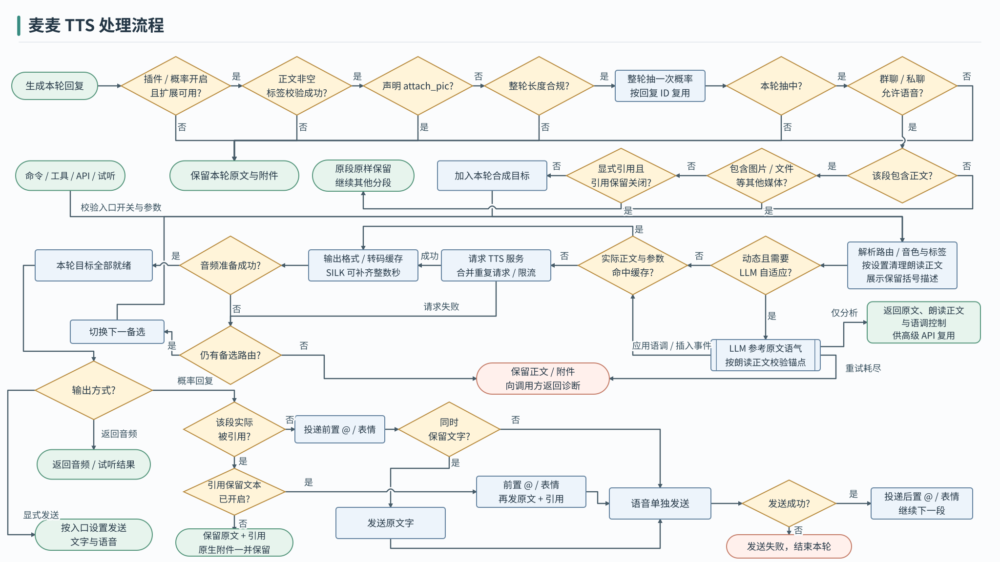

<div align="center">


# 麦麦多平台 TTS 语音插件

[](https://github.com/WhiteCloudOL/maimai-tts-plugin/releases/tag/v2.2.6)
[](#-快速开始)
[](#-快速开始)
[](LICENSE)

**为麦麦赋予说话的能力！**<br>
多平台语音合成 · 预设与克隆音色管理 · 动态语调控制 · 故障自动降级路由

[✨ 核心功能](#-核心功能) · [🌐 支持平台](#-支持平台与默认地址) · [🚀 快速开始](#-快速开始) · [💬 命令与用法](#-命令与使用方式) · [🔄 TTS 处理流程](#-tts-处理流程) · [⚙️ 进阶配置](#️-进阶功能与配置) · [🔌 插件 API](docs/plugin-api.md) · [🛠️ 各平台指南](#️-各平台配置指南)

</div>

## 🩷 问题反馈&功能建议

| 方式 | 联系 |
| :--: | :--: |
| Github Issue | [跳转](https://github.com/WhiteCloudOL/maimai-tts-plugin/issues/new/choose) |
| QQ群 | [637174573](https://qm.qq.com/q/3f2bdkDsyW) |

---

## ✨ 核心功能

- **🎨 原生 WebUI 工作台**：自适应 PC 与移动端，支持服务商管理、模型与音色收藏、在线合成试听
- **🔌 多平台与多实例**：支持 11+ 种主流/自建 TTS 平台，同一平台可创建多个独立配置（不同 Key、代理、区域）
- **🎙️ 音色克隆与设计**：内置海量官方预设音色，支持上传本地参考录音/URL 进行声音复刻，或通过文字描述生成新音色
- **🔀 高可用语音路由**：按 `Provider/Model` 设置首选与多级备选链，首选接口调用失败时自动无缝切换备选服务
- **🎭 智能语速与语调**：支持固定情感风格，或开启**动态语调**（由麦麦根据上下文自主选择语气，或由独立 LLM 自适应判断）
- **💬 多样化触发方式**：支持**聊天命令直接合成**、**LLM 工具主动调用**、**按概率将文字回复转为语音**（自动转码适配 QQ 原生 SILK 语音）。`mmtts_speak` 常驻可调用工具列表，长对话裁切后仍可直接调用。
- **🔌 SDK 插件 API**：简单与高级调用均支持返回音频和直接发送，提供服务商/模型/音色查询、参数描述、语气分析、音频复用与后台任务；详见 [对接文档](docs/plugin-api.md)。

---

## 🌐 支持平台与默认地址

| 平台 | 核心能力支持 | 默认 BaseURL |
| :--- | :--- | :--- |
| **BreezeTTS** | 本地 API / 官方在线、参考录音克隆、声音设计、动态语调与音频事件 | 本地: `http://127.0.0.1:8080/v1`<br>在线: `https://api.breeze.blue/v1` |
| **OpenAI** | 官方预设、自定义音色克隆 (需 consent ID)、指令风格控制 | `https://api.openai.com/v1` |
| **阿里云 (千问/CosyVoice/MiniMax)** | Qwen-Audio / Qwen3 / CosyVoice / 百炼 MiniMax、克隆、声音设计 | `https://dashscope.aliyuncs.com/api/v1` |
| **MiniMax 官方** | Speech 2.8/2.6/02/01、混合音色、录音复刻、声音设计、原生情感 | 国内: `https://api.minimax.cn/v1`<br>国际: `https://api.minimax.io/v1` |
| **火山引擎 (豆包)** | 豆包语音 2.0/1.0、录音复刻、图文声音设计、固定/动态语调 (COT) | `https://openspeech.bytedance.com/api/v3` |
| **硅基流动** | CosyVoice2 / MOSS、账号音色、动态参考录音 | `https://api.siliconflow.cn/v1` |
| **小米 MiMo** | 预设音色、本地/URL 音频克隆、文字声音设计 | `https://api.xiaomimimo.com/v1` |
| **GPT-SoVITS** | API v2 接入、本地/服务端参考录音与文本引导 | `http://127.0.0.1:9880` |
| **OpenAI 兼容 / 自定义** | 标准 Speech 接口，或自定义 JSON / 表单 / GET 请求与响应解析模板 | `https://example.com/v1` |

---

## 🚀 快速开始

1. **安装插件**：在 MaiBot 插件市场搜索 `麦麦多平台TTS语音` 下载并安装。
2. **添加服务商**：进入 WebUI「服务商」页面 → 点击 **添加服务商** → 选择平台并填写配置名称、API Key 和 BaseURL → 点击 **保存此平台**。
3. **配置模型与音色**：
   - 点击 **添加 / 管理模型**，搜索勾选或手动输入模型 ID 并应用。
   - 点击模型旁的 **音色与克隆**，勾选官方预设、同步账号音色或上传本地录音进行克隆，点击 **保存音色**。
4. **设置路由并启用**：
   - 进入「语音路由」，选择首选的 `服务商/模型` 与对应音色（可添加多条备选路由防故障）。
   - 在「试听工作台」测试发声正常后，点击页面顶部 **保存全部设置** 即可生效！
   - 路由选择「沿用模型默认音色」时使用该模型已保存的声音；也可为路由单独指定音色。不同模型分别保存默认音色。

---

## 💬 命令与使用方式

### 1. 聊天命令一览

在 WebUI「通用设置」中启用聊天命令后，可在群聊或私聊中使用（支持前缀 `@麦麦`）：

| 命令示例 | 功能说明 | 权限要求 |
| :--- | :--- | :--- |
| `/mmtts 你好呀` | 将后面的文本合成为语音并发送（等价别名：`/tts <文本>`、`/语音 <文本>`） | 所有用户 |
| `/mmtts model` | 查看当前已启用平台中的可用模型列表、编号及当前首选路由 | 仅管理员 (操作者) |
| `/mmtts model list 2` | 模型较多时，翻页查看第 2 页模型列表 | 仅管理员 (操作者) |
| `/mmtts model 2` | 按列表编号快速切换全局首选语音模型 | 仅管理员 (操作者) |
| `/mmtts model 硅基流动/CosyVoice2` | 按 `服务商名称/模型ID` 切换全局首选语音模型 | 仅管理员 (操作者) |

### 2. 三种语音触发模式

在 WebUI「通用设置」页面可自由组合以下使用方式：

- **🤖 LLM 语音工具 (`mmtts_speak`)**：开启后，麦麦可根据语境主动调用工具发语音。支持配置“同时保留文字”以及“是否允许临时切换音色/语速”。
- **🎲 概率语音回复**：设置转换概率（如 `0.2` 即 20%）、字符数范围及群聊/私聊开关。麦麦的常规文字回复将按概率自动转为语音（支持“同时保留文字”和“引用回复保留文本”）。
- **⌨️ 显式命令触发**：通过上述 `/mmtts`、`/tts`、`/语音` 指令强制让麦麦朗读指定文本。

> **💡 聊天平台兼容**：默认开启 **QQ 原生语音（SILK）** 自动转码，完美支持 **QQ 官方机器人、NapCat、SnowLuma** 等适配器；其他平台可切换为「保留服务商原始格式」。

「通用设置 → 语音输出」中的 **输出整数秒语音** 默认开启：在 SILK 聊天语音末尾补静音，将包含编码尾包的实际时长向上补齐至整数秒，避免SnowLuma裁断。

**朗读时剔除括号动作描写** 默认关闭。开启后，语音跳过含中文的圆括号描述，文字与语音历史保留原文。自适应可参考原文判断语气，Breeze 事件按清理后的朗读正文定位。

---

## 🔄 TTS 处理流程

[](assets/tts-processing-flow.svg)

<details>
<summary>展开查看判断条件、默认值与参数说明</summary>

### 触发与概率判定

| 阶段 | 判定条件 | 处理方式 |
| :--- | :--- | :--- |
| 聊天命令 | 插件及聊天命令开关开启，存在朗读正文和聊天流 | `/mmtts`、`/tts`、`/语音` 直接进入合成链。 |
| 语音工具 | 插件及 LLM 语音工具开关开启，参数有效 | `mmtts_speak` 按整体路由合成；临时音色和语速受对应开关控制。 |
| 插件 API / WebUI | API 开关与请求参数、目标模型音色满足要求；试听使用工作台选择的目标 | 简单/高级 API 选择返回音频或发送语音；WebUI 返回试听音频。详见 [API 对接文档](docs/plugin-api.md)。 |
| 概率回复入口 | 插件与概率语音开启，当前 `reply` 带有概率扩展，正文及语调标签有效 | 同一回复 ID 保存一次判定；重复 Hook 沿用该判定。 |
| 整轮抽样 | 清理控制标记后的**整轮正文**长度处于最短值与最长值之间，且未声明 `attach_pic` | 单次回复只抽取一次概率，分段共享结果。`0` 保留文字，`1` 选择语音；中间值按配置概率抽样。@ 与表情声明继续参加抽样。 |
| 聊天范围 | 当前群聊或私聊对应的概率语音开关开启 | 抽中后，按 MaiBot 已经拆分的消息选择正文；未抽中或范围关闭时保留原消息。 |

### 分段与发送

| 消息内容 / 设置 | 处理方式 |
| :--- | :--- |
| 纯文字段 | 正文合成后单独发送语音；开启“概率语音同时保留文字”时，先发送该段原文字。 |
| 同段包含 @ | @ 按其位于正文前或正文后的位置独立发送，语音单独发送；保留目标用户 ID、昵称与群名片。 |
| 独立表情段 | 保留 MaiBot 原有发送流程，正文段继续参加语音转换。 |
| 正文与表情同段 | 正文进入合成，表情按原顺序分开发送；保留描述、哈希与二进制等原有字段。 |
| 图片、文件及其他媒体段 | 该段保留原生内容；其他可转换正文段继续处理。显式 `attach_pic` 声明沿用整轮保留原文的判定。 |
| **引用回复保留文本：开启（默认）** | 原文本与引用作为同一条消息发送，随后单独发送对应语音。 |
| **引用回复保留文本：关闭** | 已显式带 `reply` 引用内容的分段保留原文本与引用，并跳过该段 TTS；其他分段独立处理。首段自动引用与 `quote_previous` 请求由 MaiBot 在合成后确定是否生效；最终被引用的段按原逻辑保留文字与引用，已生成的语音留在合成缓存中。 |
| 合成失败或整轮超时 | 概率回复整轮保留清理过控制标记的原文字与附件；工具调用保留一次可见正文。诊断写入日志，并返回 LLM 或 API/WebUI 调用方。 |
| 发送回执 | 同段后置 @ 与表情在语音发送成功后继续投递；附件状态消费一次并按时清理。同一缓存音频的并发回复分别关联各自的正文与附件。 |

### 共享合成链

1. **选择路由与音色**：整体首选按配置顺序连接备选路由；指定服务商/模型的 API 与试听使用所选目标。解析实际音色及其风格、语速、语调继承设置。
2. **准备朗读正文与语调**：先解析控制标签，再按设置清理正文中的括号动作描写。已有语调标签或 Breeze 局部语气优先。概率回复开启 LLM 自适应或 API 选择自动模式时，语音辅助 LLM 按平台能力补充语气。Breeze 事件在同一份朗读正文上生成、校验和插入。插件 API 支持先分析，再将原文和控制结果交给高级调用合成。
3. **校验与纠正**：工具及普通动态语调的格式错误携带原提示、错误输出与校验原因重新生成参数；辅助 LLM 调用失败与格式校验失败共用重试次数，默认 2 次，可选 0–5 次。纠正耗尽后结束本次 TTS，聊天正文保留可见文字。
4. **缓存与请求**：按最终正文、音色、语调指令和平台参数查找音频缓存；相同请求合并执行。缓存未命中时受并发数限制调用平台；平台合成或转码失败后继续已配置的备选路由。每次实际 TTS 请求记录 INFO 日志，包含正文、目标和生效参数。
5. **输出与投递**：返回原始音频，或按聊天设置转为 SILK。转码结果独立缓存，“输出整数秒语音”可在尾部补静音。聊天文字与语音历史正文使用各自的原文，过滤控制标记并保留括号描述。

</details>

---

## ⚙️ 进阶功能与配置

### 🎭 语音语调与情感控制
在「服务商」中填写**平台默认风格**；模型和音色的风格描述均为选填，留空按 **“音色 → 模型 → 平台默认”** 逐级继承，填写后覆盖上一级。风格输入框按模型、音色和资源的支持范围显示，平台默认风格仅对支持的组合生效。MiniMax 等平台使用原生情感选项；自定义 HTTP 请求需在模板值中引用 `{{instructions}}` 才能设置风格。

同一音色 ID 同时有通用收藏与模型专属收藏时，当前模型优先使用专属收藏的风格、语速、语调和训练状态；其他模型继续使用各自的专属配置或通用配置。

在「模型设置」或「音色编辑」中可选择三种模式：

1. **关闭语调控制**：使用已配置的风格与平台原生参数。
2. **固定语调**：固定选择开心、温柔、严肃等语气，所有合成自动应用。
3. **动态语调**：勾选允许列表后，提供两种驱动方式：
   - **主模型标签驱动**：麦麦回复时在开头输出如 `[mmtts:happy]今天很高兴见到你`，插件校验后自动提取为合成参数并清除标签文本。
   - **概率语音 LLM 语调自适应**：在「通用设置」中开启后，无需主回复模型输出标签，当抽中概率语音时，由指定任务（如 `utils`、`replyer`、`planner`、`vlm`）绑定的模型与服务商判断语气。仅对动态语调路由生效；单次超时默认 60 秒，调用失败与参数校验失败共用重试次数，默认 2 次，可选 0–5 次，推荐使用低延迟模型。

开启 LLM 语调自适应时，需要所有路由模型与音色均支持动态语调，否则将禁止开启。

<details>
<summary><b>📂 点击展开：本地参考录音导入指南（Windows / Linux / Docker）</b></summary>

<br>

本地录音默认存放在插件数据目录下：`MaiBot/data/plugins/WhiteCloudOL.maimai-tts-plugin/reference_audio/`（支持 MP3/WAV 等常见格式）。

**导入步骤**：
1. 将音频文件放入上述目录，或放到 MaiBot 所在服务器任意可读路径。
2. 打开 **服务商 → 对应模型 → 音色与克隆**，将参考音频来源设为 **麦麦本地文件**。
3. 点击 **选择文件** 直接选取，或点击 **从服务器路径导入** 输入服务器上的绝对路径（插件会自动复制到录音库并生成相对路径 `reference_audio/xxx.wav`）。

**不同部署环境的路径对照**：
- **Windows / Linux 原生部署**：直接填写相对路径 `reference_audio/sample.wav`，或系统绝对路径（如 `C:\Audio\voice.wav`、`/srv/audio/voice.wav`）。
- **Docker 容器部署**：路径以 **MaiBot 容器内部文件系统** 为准。
  - 若挂载了 `./data/MaiMBot-plugin-data:/MaiMBot/data/plugins`，可直接将录音放入宿主机的 `./data/MaiMBot-plugin-data/WhiteCloudOL.maimai-tts-plugin/reference_audio/` 下，然后在 WebUI 填写 `reference_audio/sample.wav`。
  - 或使用命令导入：`docker cp ./sample.wav maim-bot-core:/MaiMBot/data/plugins/WhiteCloudOL.maimai-tts-plugin/reference_audio/sample.wav`

</details>

<details>
<summary><b>🌐 点击展开：网络代理与 config.toml 运行配置</b></summary>

<br>

**服务商独立代理**：在每个服务商设置中展开「网络代理」，可单独选择：**关闭代理**、**系统环境代理**、**自定义 HTTP/HTTPS 代理**（如 `http://127.0.0.1:7890`）或 **沿用插件运行设置**。

**全局运行设置 (`config.toml`)**：可在 MaiBot 插件配置页调整以下底层参数：

| 配置项 | 默认值 | 用途说明 |
| :--- | :--- | :--- |
| `plugin.enabled` | `true` | 插件总开关 |
| `runtime.log_level` | `INFO` | 日志级别 (`DEBUG` / `INFO` / `WARNING` / `ERROR`)，搜索 `[TTS]` 排查问题 |
| `runtime.timeout_seconds` | `90` | 单次平台请求超时时间（秒） |
| `runtime.max_text_length` | `4096` | 单次合成的最大字符数上限 |
| `runtime.max_audio_size_mb` | `20` | 单次音频大小上限（MiB） |
| `runtime.max_concurrency` | `2` | 最大并发合成任务数 |
| `runtime.list_cache_ttl_seconds` | `300` | 模型与音色列表缓存时间（秒，0 为关闭） |
| `runtime.audio_cache_ttl_seconds`| `300` | 合成与转码音频结果缓存时间（秒，0 为关闭） |
| `runtime.cache_max_size_mb` | `64` | 内存音频缓存最大容量（MiB，0 为关闭） |
| `runtime.proxy_url` | `""` | 全局默认代理地址（供选择“沿用插件运行设置”的服务商使用） |
| `runtime.use_system_proxy` | `false` | 全局是否读取系统环境变量代理 |

**数据备份**：插件所有配置保存在 `MaiBot/data/plugins/WhiteCloudOL.maimai-tts-plugin/studio.json`（含密钥，请注意保密），参考录音保存在同级 `reference_audio/` 文件夹。

</details>

---

## 🛠️ 各平台配置指南

> 点击下方对应平台展开查看详细配置步骤与专属参数说明：

<details>
<summary><b>1. BreezeTTS（本地 API / 官方在线 / 局部语气与音频事件）</b></summary>

<br>

本地API 可采用两个服务端，区别在于是否有鉴权功能与排队功能：  
官方原版：[HoppouAI/Breeze-TTS-2.cpp](https://github.com/HoppouAI/Breeze-TTS-2.cpp)  
我维护的鉴权排队版：[WhiteCloudOL/Breeze-TTS-2.cpp](https://github.com/WhiteCloudOL/Breeze-TTS-2.cpp)   
两种服务端均可使用，其中官方无需填写密钥，我的版本则包含鉴权，需要设置并填入API-KEY  
**详细步骤**见 [BreezeTTS 本地API配置](docs/breeze-local-api.md)  

- **接入方式**：在平台连接中选择 **本地API** 或 **Breeze 官方在线**（`https://api.breeze.blue/v1`）。
- **本地音色与参数**：支持同步服务端音色库、直接填写音色 ID、创建服务端参考音色、动态参考录音及文字设计；MP3 / WAV 录音由插件转换为标准 WAV 上传。模型设置提供 CFG、随机种子及 C++ 采样与长文参数。
- **在线音色目录**：默认同步中文音色，可在模型参数中修改「同步音色语言」并填写关键词，按名称或声音描述筛选。每次最多同步 1000 项；选择全部语言时建议配合关键词。目录筛选不改变已收藏音色，也不影响合成语种。
- **在线音色导入与创建**：「导入音色 ID」收藏官网已有的完整 `voice_id`，保存前核验当前账号访问权限；「音色克隆」与「声音设计」向官方创建音色，再保存返回的正式 `voice_id`。收藏名称用于本地显示，风格描述用于每次合成的 `instructions`。
- **模型试听与聊天路由**：「模型设置」中选择默认音色，并显示试听实际使用的 `voice_id`；聊天按「语音路由」选择音色，选择“沿用模型默认音色”时与模型试听保持一致。
- **音色与 CFG 建议**：
  - **原声复刻**：在「参考音色」中配置本地录音与完整准确的文字稿，语调选关闭，**CFG 建议设为 `1`**。
  - **语调引导 / 声音设计**：开启固定/动态语调，或使用文字描述进行「声音设计」时，本地API 的 CFG 可从 `2–3` 开始调整；在线服务可使用 `1` 或 `4`。
- **局部音频事件与自由语气（动态语调专属）**：
  开启「动态语调」后，麦麦可在台词中穿插控制标记：
  - **音频事件**：如 `[轻笑]`、`[叹气]`、`[耳语]`、`[唱歌]`；本地API 英文使用 `(laugh)` 等，在线服务使用 `(laughs)` 等。
  - **停顿引导**：中文 `[停顿]`、英文 `(pause)`。
  - **自由语气**：如 `[语气:轻声而温柔][轻笑]你终于来了。[停顿][语气:认真而坚定]接下来我们一起面对。`（每条回复最多 8 个自由语气标记）。

</details>

<details>
<summary><b>2. 火山引擎（豆包语音 2.0 / 音色资源 ID 与模型版本对应）</b></summary>

<br>

- **连接与鉴权**：BaseURL 填 `https://openspeech.bytedance.com/api/v3`。支持直接填写 **API Key**，或选择 **Access Token** 并配合填写 App ID。
- **核心概念（避免 `55000000 resource ID is mismatched` 报错）**：
  **合成资源 ID** 决定音色归属的产品计费包，**模型 ID** 决定合成效果版本，请按音色类型对应配置：

| 音色类型 | 合成资源 ID (`Resource ID`) | 推荐模型 (`Model`) 与语调支持 |
| :--- | :--- | :--- |
| 公版豆包语音 2.0 (内置 450 个预设) | `seed-tts-2.0` | 选 `seed-tts-2.0`，支持整段语音指令 (`context_texts`) |
| 公版语音合成 1.0 | `seed-tts-1.0` / `seed-tts-1.0-concurr` | 原生朗读，部分多情感音色支持原生情感参数 |
| 复刻 / 声音设计 2.0 | `seed-icl-2.0` | 选 `seed-tts-2.0-expressive`（支持语音指令与 `<cot>` 标签）或 `standard` |
| 复刻 / 声音设计 1.0 | `seed-icl-1.0` / `seed-icl-1.0-concurr` | 旧版复刻资源，不发送 2.0 效果版本 |

- **录音复刻**：可使用控制台已购买的预付费槽位（`S_...`），或填写自定义后付费 ID（8–256 位字母、数字和下划线，避开官方保留前缀）上传本地录音。
- **声音设计**：使用预付费 `S_...` 槽位，通过文字描述或参考图片创建音色。可在工作台直接 **查询音色状态** 与 **播放平台试听**。

</details>

<details>
<summary><b>3. 阿里云（千问 Qwen / CosyVoice / 百炼 MiniMax）</b></summary>

<br>

- **地址**：默认 `https://dashscope.aliyuncs.com/api/v1`（或业务空间专属地址）。
- **模型家族**：
  - **Qwen-Audio 3.0/3.1 TTS**：内置海量预设，支持本地录音克隆、声音设计及自然语言 `instruction` 语调控制。
  - **Qwen3-TTS**：支持 HTTP 与 Realtime；如需语调指令控制，请选择 `Qwen3 Instruct` 系列模型。
  - **CosyVoice (v2 / v3 / v3.5)**：支持 HTTP / WebSocket 协议切换；支持本地录音/URL 复刻与声音设计（需填写 1–10 位英数前缀）。v3.5 和 v3 Flash 的复刻、设计音色支持自然语言指令；v3 Plus 的复刻、设计音色使用原生参数，部分 v3 预设音色使用固定格式情感指令。指令上限 100 字符，汉字计 2，其余字符（含标点、假名和谚文）计 1。详见[官方指令说明](https://help.aliyun.com/zh/model-studio/realtime-tts-user-guide)。
  - **阿里云_MiniMax**：采用百炼接口调用 Speech 2.8/02，复刻录音需使用 **公网音频 URL**（10秒~5分钟）。
- **音色管理**：克隆与设计音色在窗口内支持 **查询审核状态**、更新录音或同步删除云端音色。

</details>

<details>
<summary><b>4. MiniMax 官方平台</b></summary>

<br>

- **模型支持**：`speech-2.8-hd/turbo`、`speech-2.6-hd/turbo`、`speech-02-hd/turbo`、`speech-01-hd/turbo`。
- **特色能力**：
  - **多协议**：支持同步 HTTP 完整音频、HTTP SSE 流式、WebSocket。
  - **混合音色**：最多可添加 4 个音色 ID 并分别设置权重（1–100）融合发声。
  - **克隆与设计**：支持直接上传本地 MP3/M4A/WAV（最大 20MB）、公网 URL 或复用已上传文件 ID 进行快速复刻；支持文字声音设计（创建后 7 天内合成一次即可永久激活）。
  - **原生情感与音效**：内置原生 `emotion` 情感控制，支持音高、回响等声音效果调节。

</details>

<details>
<summary><b>5. 小米 MiMo / 硅基流动 / GPT-SoVITS</b></summary>

<br>

- **小米 MiMo (`https://api.xiaomimimo.com/v1`)**：
  - `mimo-v2.5-tts`：使用 9 个官方预设音色。
  - `mimo-v2.5-tts-voiceclone`：在“音色与克隆”中绑定本地录音或 URL，每次合成实时克隆。
  - `mimo-v2.5-tts-voicedesign`：填写声音描述（年龄、口音、风格），支持固定/动态语调指令。
- **硅基流动 (`https://api.siliconflow.cn/v1`)**：
  - 支持 `FunAudioLLM/CosyVoice2-0.5B`（预设格式如 `模型ID:anna`，支持官方指令前缀）与 `MOSS`。
  - **CosyVoice2 风格与语调**：建议使用“声音清甜。”“活泼轻快。”这类简短表达，风格与语调合计约 20 字符作为经验参考。模型、音色窗口实时展示继承后与默认语调合并的指令及字数；普通动态语调、语音工具和 LLM 自适应共用该模型的简短表达规则。编辑的风格与自定义语调按原文保存，实际合成指令参与缓存区分。
  - 支持上传本地音频创建账号音色，或保存为动态参考录音随请求发送（上限 4 MiB）。注意采样率需与格式匹配（如 MP3 选 32000/44100，Opus 选 48000）。
- **GPT-SoVITS (`http://127.0.0.1:9880`)**：
  - 适配 API v2。在音色窗口配置参考录音、参考文本与语种。
  - 若与麦麦同机部署，选择「麦麦本地文件」；若异机或分容器部署，选择「GPT-SoVITS 服务端路径」并填写服务端可访问的路径。

</details>

<details>
<summary><b>6. OpenAI 与自定义 HTTP 接口模板</b></summary>

<br>

在 **OpenAI兼容服务 → 模型设置 → 请求协议** 中可选择：
1. **OpenAI 官方 Speech**：支持 `gpt-4o-mini-tts`（支持 `instructions` 语调指令）、`tts-1`、`tts-1-hd`。拥有权限的账号可填入 `cons_...` 授权记录 ID 上传本地录音克隆音色。
2. **自定义 HTTP 格式**：适配任意第三方/自建 TTS 接口。支持自定义路径、鉴权头、请求方式（JSON / 表单 / GET）和响应解析（二进制流 / JSON Pointer 提取 Base64 或 URL / SSE）。

**自定义请求体常用模板变量**：
```json
{
  "model": "{{model}}",
  "text": "{{text}}",
  "speaker": "{{voice_id}}",
  "speed": "{{speed}}",
  "style": "{{instructions}}",
  "ref_audio": "{{reference_base64}}",
  "ref_text": "{{reference_text}}"
}
```
*(支持变量：`{{text}}`、`{{model}}`、`{{voice}}`、`{{voice_id}}`、`{{speed}}`、`{{response_format}}`、`{{sample_rate}}`、`{{instructions}}`、`{{api_key}}`、`{{reference_audio}}`、`{{reference_base64}}`、`{{reference_url}}`、`{{reference_text}}`)*

</details>

---

## ❓ 常见问题排查

| 遇到的情况 | 排查与解决建议 |
| :--- | :--- |
| **平台合成报错 / 没声音** | 先在「试听工作台」指定该平台与模型单独测试，根据弹窗报错核对 API Key、余额、BaseURL、模型权限或代理设置。 |
| **火山引擎报 `55000000` 错误** | 音色所属的合成资源 ID 与音色类型不匹配。复刻/设计 2.0 音色需将资源改为 `seed-icl-2.0`，公版 2.0 音色用 `seed-tts-2.0`。 |
| **找不到本地参考录音** | 对照 WebUI 显示的录音目录路径，检查文件是否已上传至**运行 MaiBot 的机器/容器内**，并确认进程有读取权限。 |
| **硅基流动报采样率错误** | MP3 格式请选择 `32000` 或 `44100`，Opus 请选择 `48000`。 |
| **麦麦不自动发语音** | 先用 `/tts 你好` 测试语音发送链路是否正常；若命令正常，请检查「通用设置」中的概率语音开关、字符长度范围，或将日志调为 `DEBUG` 搜索 `[TTS]` 查看跳过原因。 |

---

## ✔️ 开源许可

- 本项目基于 [AGPL-3.0](LICENSE) 协议开源。
